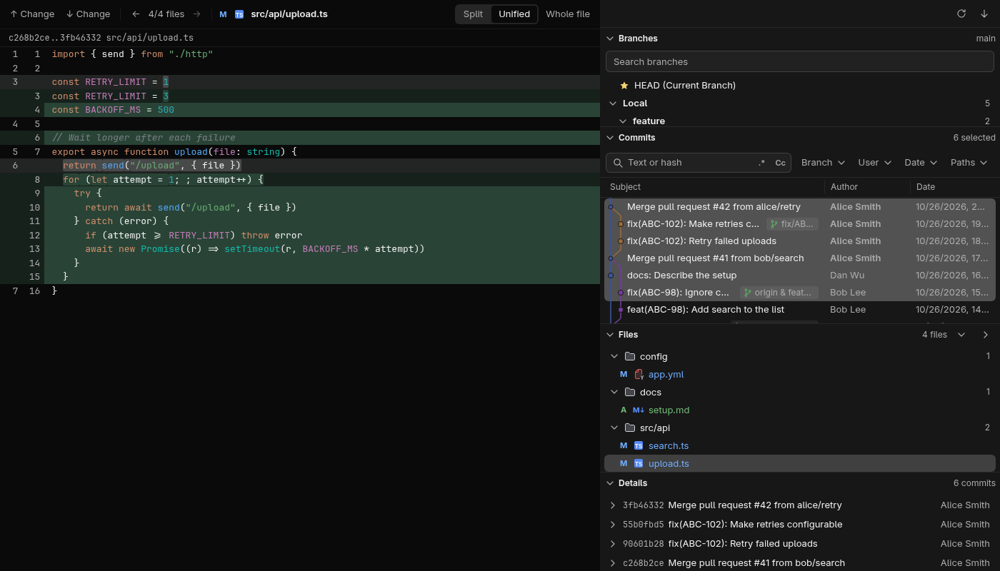
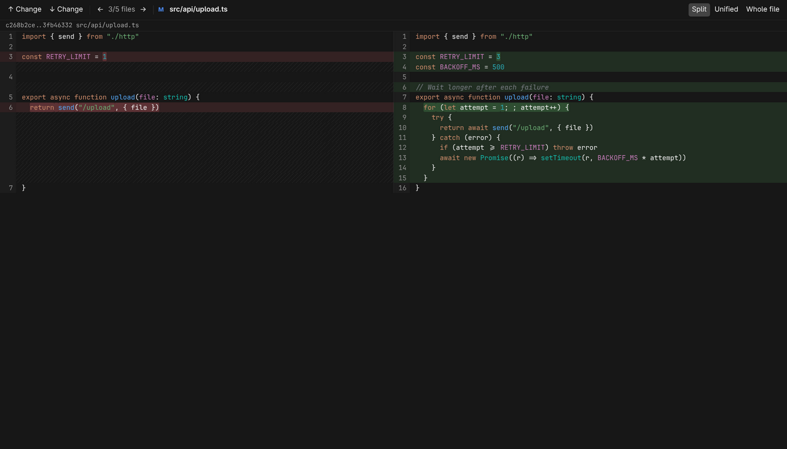
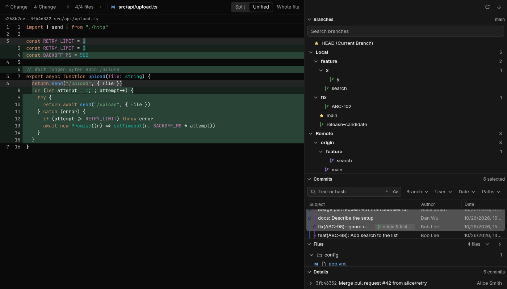

# Git for Orca



## About this fork

This is a fork of [emamalet/Orca-git-log-panel](https://github.com/emamalet/Orca-git-log-panel) that reshapes the interface after the WebStorm Git tool window: a sidebar with a branches tree, the commit list and the files of a multi-commit selection, and a Diff tab for the file you click. The Git engine (`src/worker`) is kept as close to upstream as possible. The design is in [docs/superpowers](docs/superpowers) and the engine review in [docs/engine-review.md](docs/engine-review.md).

To pull in upstream changes:

```sh
git fetch upstream && git log --oneline main..upstream/main
```

Then bring over what you need with `git cherry-pick` or `git merge upstream/main`. Pull requests are not sent to upstream.

An [Orca](https://www.onorca.dev) plugin that adds a WebStorm-style **Git** view to Orca: a branch tree, a
colored commit graph, the files changed by a whole multi-commit selection, a syntax-highlighted diff in an
editor tab, and a right-click menu to rewrite history. The interface follows Orca's language (English and Russian).





## Features

- **Sections**: Branches, Commits, Files and Details stack in a column, like the WebStorm Git tool window. Click
  a header to collapse a section to one line with its summary (number of selected commits or files);
  drag the edge between open sections to resize them (a line shows under the pointer). The layout is
  remembered.
- **Push** next to Fetch (`Shift+K`): a dialog lists the commits that go and where (the branch's push
  target, as a plain `git push` would pick it); it sends exactly the commit the dialog listed. A branch
  git would push nowhere (no upstream, or under `push.default=simple` an upstream of another name, like a
  branch made from `origin/main`) is published: pick the remote and the name on it (its own name by
  default, never `main` by accident), and the upstream is set. When the remote has commits the branch lacks, the banner
  offers a force push with lease: its confirmation lists the commits the remote would lose, offers a
  backup of the remote's tip, and the push is refused if the remote changed since the last fetch.
- **Current branch** at the top left, next to Refresh, Fetch and Push: the branch (or the commit of a detached
  HEAD), the commits to pull (↙, blue) and to push (↗, green) against its upstream as of the last fetch,
  in WebStorm's colors and with its 99+ for more, and a
  yellow mark while a rebase, merge, cherry-pick or revert is in progress. Its tooltip names the
  repository folder and the upstream.
- **Commit graph**: colored lanes, merges, ref labels (`origin & main`, tags, HEAD), commits not
  reachable from HEAD are dimmed.
- **Filters**: text or hash (with regex `.*` and match case `Cc`) in a search across the full width of the
  Commits section; Branch, User, Date and Paths in a row under it.
- **Branch tree**: HEAD, Local, Remote and Tags, with branches grouped into folders by prefix (`feature/`,
  `fix/`); search by name. A repository opens with HEAD selected, so the log shows the current branch. Click a branch to filter the log by it (click again to clear and show all branches), double-click
  to jump to its commit. Right-click for checkout, new branch from it, rename,
  delete (local only; an unmerged branch asks first), merge into the current branch and rebase the
  current branch onto it. The keys of the Files tree below work here too; Enter filters by the branch.
- **Files of the selection**: the changed files of all selected commits as a folder tree with status
  letters (added, modified, deleted, renamed), expand/collapse all. For each file the diff runs from its
  state before the earliest selected commit that touched it to its state after the latest one, so a
  selection across a merge works too. A click (or Enter) opens the file's diff in the Diff tab.
  Under each file stand its **review notes**, as Azure DevOps lists threads in the file tree of a pull
  request: the notes the file's diff shows (none under a file renamed without changes or changing type)
  and the notes of another version of the file carried to it (from any commit but a later one in its
  history, so also from another branch: see the Diff tab), at their new lines and with no mark, as in
  the Diff tab; one row each: a dot of the state (hollow: not sent; yellow: sent, no answer yet; blue:
  answered; green: confirmed or fixed), the first line, the start of the first message. Resolved notes
  come last, with a check and pale; the file row counts the others. A new-side note of another version
  whose lines this version changed is **outdated**: it stands at its own first line with a dashed dot,
  among the open or the resolved ones as its state is, and the file row counts it while it is open; an
  old-side one whose lines changed is not listed under the file. Hover a note
  for its path, lines, side, state and whole first message (an outdated one also names the commit after
  which its lines changed); a click (or Enter) opens the file in the Diff tab at the note's card, and on
  an outdated note opens the commit it was written in, as its row in the tab's Notes list does (a refusal
  shows in the banner). The rows follow every change of the notes, here or in the Diff tab. When the
  notes cannot be loaded, the banner says so and the files show no notes.
  Tree keys (here and in the branch tree): ↑ / ↓ move between rows, → opens a folder or steps into it,
  ← closes it or steps up to the parent folder (from a note, to its file), Space opens or closes a
  folder; each tree is one Tab stop, and a redraw keeps its scroll position.
- **Details section**: one row per selected commit (short hash, title, author); click a row to expand
  the full message, author, committer, date and branches. A single selected commit is expanded at once.
- **Diff tab**: one editor tab per repository; the next file you open replaces its content. The tab's
  selection and the file it shows are kept in the plugin's storage: Orca stops an idle plugin worker and
  starts a new one on the next request, and the new one shows them again instead of the placeholder. Side by
  side or unified, with changed words highlighted and syntax highlighting for 24 languages, in the colors
  the **Diff colors** setting picks. **Orca** (the default): the colors and font of Orca's file editor
  with a theme that brings no editor colors of its own (Monaco's dark and light themes), because Orca
  does not pass a theme's editor colors to plugins
  ([stablyai/orca#40879](https://github.com/stablyai/orca/issues/40879)); a theme with its own editor
  colors shows other colors in Orca's editor. **WebStorm**: WebStorm 2026.2's Islands Dark and Islands
  Light, the editor background included. The highlighter knows tokens, not meaning: it cannot tell a
  local function from a global one the way WebStorm does, so a few names are colored by their place
  instead (parameters plain, object keys and properties as fields). A change of the setting applies at
  once. Toggle **Whole file** for full context: a 5 px map of the whole file then runs along the right
  edge, past the scroll bar, with a mark for each block of changes (green added, blue modified, gray
  deleted: the colors of the file statuses) and, over them, a yellow mark for each review note (faded
  when resolved). The marks are measured from the rows shown, so they follow wrapped lines and opened
  cards; a hover names the lines (and the note's first line), a click scrolls there. Jump between
  changes with F7 / Shift+F7 and between the files of the selection it was opened from with ← / → (keys or header buttons) or Alt+↑ /
  Alt+↓ (counter "3/5 files"); the panel's Files section highlights the file the tab shows. Merge
  commits are compared with their first parent. The review has its own group at the end of the header,
  after a divider: **Notes**, outlined, and **Send to an agent**, filled with Orca's primary color as the
  tab's main action, each with its count in a circle.
- **Review notes** in the Diff tab: select text in the code, then press **Note**, the button filled with Orca's
  primary color that appears at the end of the selection, or `Ctrl+Shift+A`, and write a note for an agent in markdown (Enter saves,
  Shift+Enter adds a line, Esc cancels). A note belongs to one side: the column the selection starts in
  (split), or in unified the line it starts on (a deleted line is the old side, any other the new one);
  while you select, the other side stays out of the selection. The note is tied to the content of the
  file on its side (its blob), so it shows in every diff where that side is the same, also after a
  rebase or an amend that left the file alone. In a diff whose side holds another version of the note's
  file at the note's path (selecting the note's commit with later ones, a later commit, and also the
  commit a fixup, squash or rebase made of the note's, or a commit of another branch), a note whose lines
  that version did not change stands on their new lines, as if written there, without a mark; the worker
  compares the two versions with `git diff`, as GitLab and Gerrit carry comments, and carries a note to
  every version of its file but one whose commit is in the history of the note's (an older version). So
  a note of a branch not merged yet shows, carried or outdated, on that file in the commits of other
  branches too, and the notes of commits a rebase left behind on the older commits of the new base. A
  new-side note whose lines changed is outdated and is not drawn in the code; an old-side note whose
  lines changed is not shown in that diff. A file that changes type (a file turned into a symlink or
  back) takes no notes and shows none, as it has none in the panel's Files section. A note is a
  **thread**, as in Azure DevOps pull requests: its card stands under the last selected line, in the half of its side in split, with the selected text
  highlighted. On top, the thread's state (Resolved; Sent, no answer yet; Not sent; or the verdict of the
  agent's last answer and Fixed), Send again while a send has no answer and **Resolved** (small outlined
  buttons with an icon and a label; **Open again** in their place on a resolved thread), and Delete the
  thread (an icon, as Edit and Delete of a message are). Below, the messages oldest first, each with its author (You, or Agent and its kind), its time
  and a Delete button; the agent's messages stand on a tint and carry their own verdict and Fixed; your
  messages not sent yet say Not sent and have Edit (sent text stays as the agent saw it). Deleting the
  last message deletes the thread; an agent's answer you delete does not come back. Every Delete of a
  thread or a message, here and in the Notes list, asks once more in place: the first press turns the
  button red with "Press again to delete" (in the list, its tooltip says it), the second deletes; moving
  the focus away, Esc or a redraw of the thread leaves it as it was. **Reply…** under the
  messages opens the same editor as a new note; the reply stays unsent while the thread waits for an
  answer. A resolved thread folds to one line (Resolved, the start of its first message and the count of
  messages) that opens and closes on a click; it takes no reply and is not sent until **Open again**.
  One editor is open at a time: typed text or attached images are not dropped for another one.
  **Images** go with a new note or a reply: paste one into the editor (Ctrl+V; text pasted with it goes in
  as text), or press **Attach a file**
  (the image icon) for a path field that suggests the images and folders of the folder typed so far, with
  the keys of the skills' field below (a full path, `~/…` or from the repository root); closing the field
  clears what it said under it. A message takes up
  to 5 PNG, JPEG, GIF or WebP images of up to 5 MiB each; they stand under the field, each with × to take
  it off, and a refused image says why under the field. A message needs text: Enter with images and no
  text says so under the field. An edit keeps the message's images as they are.
  A message shows its images as thumbnails 96 px high under its text; a click or Enter opens one over the
  tab with its name and size, and Esc, a click outside it or × closes it. Links open
  in the browser. **Notes** in the tab's header counts the threads not resolved and lists every
  thread of the repository with its file, lines, side, state, count of messages and the start of the
  quote and of the first message, resolved ones last and dimmed. **Outdated** (a dashed label; its
  tooltip names the note's commit) marks a new-side note of HEAD's history whose lines HEAD has changed,
  or whose file HEAD no longer has; the note stays open until you resolve it. Copy all copies them as markdown with
  every message under its author, Delete all asks once more and deletes every thread of the repository.
  A click on a note opens it where it shows: in a file of the tab (also the file shown, when the note is carried to it), scrolled to, with Whole file when its
  lines are outside the changed regions; else the tab opens the commit whose own diff writes the note's
  content, scrolls to it there, and the panel showing that repository selects the commit in Commits (on
  HEAD's history first, else among every branch; of two notes clicked in a row the later one wins, even
  while the earlier one's commit is still being loaded) and highlights the note's file in Files, without
  taking the keyboard. While a note or a reply you are writing holds text or images, the tab does not drop it
  for another file or commit asked for from the panel or the Notes list: it shows the editor, says under it
  that the other file opens once you save or cancel the note, and opens it then. Opening the list loads
  the notes again, so the agent's answers are read then too. Notes are kept in the plugin's storage, up
  to 200 per repository (see Limitations). When the notes cannot be loaded, the answers cannot be saved,
  or a delete, Send again, Resolved, Open again or the opening of a note's commit is refused, the Notes
  button's text and border turn yellow, its tooltip says why, and so does
  a line at the top of the list.
- **Send notes to an agent**: **Send to an agent** in the Diff tab's header, with the count of unsent
  notes (shown while a note is unsent), opens a menu of agent kinds (the ones Orca lists, plus claude and codex; the last one used
  first): all unsent notes, or only those of the file shown. The plugin writes a folder
  `.orca-git-log/review-<id>/` in the workspace with `notes.md` (every note: file, lines, the commit it
  was written on, an `Outdated:` line when HEAD changed its lines, as the Notes list marks it, the selected text, the whole thread of messages oldest first with the new ones marked NEW and each answer of the agent naming the messages it answers, and how to answer; the agent writes one answer file per thread, stored as the agent's message of that send), `SKILL.md` (a short guide for an
  independent reviewer) and an empty `answers/`, adds `.orca-git-log/` to the repository's
  `.git/info/exclude`, marks the notes sent and starts a new agent in that workspace whose prompt names
  the three paths. If the agent does not start, the folder is removed and the notes go back to unsent;
  the reason shows under the button. The next send goes to that same agent, typed into its terminal, while the terminal is open in the focused workspace, the agent is `done` and the repository's path holds no character a shell reads specially; the menu then offers "to the same agent" instead of the kinds. A busy or closed agent means a new one: pick a kind. If the terminal does not take the text, the send is undone and the next one starts a new agent. One send per repository runs at a time, and a note waits for one
  answer at a time: while its last send has no answer it shows "Sent, no answer yet" and is not sent again.
  A message may carry up to 5 images (PNG, JPEG, GIF or WebP, 5 MiB each). The worker keeps each as a file `.orca-git-log/images/<12 hex of its sha256>.<kind>` (the same bytes make one file; a file goes when no message uses it any more, and an upload never attached to a message goes a day later), `notes.md` lists their full paths in an `Images:` line right under the message's header line (the message's text is indented, so a line of text never passes for it) and tells the agent to open them, and an answer file that shows `` of a file right inside its `answers/` folder (the bare file name, as `notes.md` tells the agent) brings that image into the agent's message.
- **Review skills** of a repository: under the notes in the Notes list, set up to 10 skills the agent
  takes first, in their order, before the project's own rules and skills and the plugin's guide. A skill
  is an `.md` file or a skill folder, as a full path, `~/…` or from the repository root (a trailing `/`
  is dropped), and must exist when it is added; one gone from the disk since can stay or be removed.
  **Add a skill** opens a path field that suggests the `.md` files and the folders of the folder typed
  so far: ↑ / ↓ pick, Enter or Tab take a suggestion (a folder opens in the field, a file is added), Done
  or Enter with no suggestion take the typed path (while the suggestions for what was just typed are on
  their way there are none), and with nothing typed close the field; × removes a skill. A refused path shows under the field, a refused removal
  under the list. When notes are sent, `notes.md` lists the skills that exist then, each once, as full
  paths in order, and the prompt tells the agent to use them first; without skills the prompt is as
  before. The skills are kept in the plugin's storage.
- **Answers under the notes**: the agent writes one file per note to `answers/<note id>.md`: `verdict:
  answered | confirmed | refuted | unclear`, optionally `fixed: yes | no`, a blank line and a very short markdown
  answer: the answer itself with the facts (code, `file:line` or a screenshot of the design mockup). The plugin's
  guide (`SKILL.md` in the review folder) tells the agent that a note is a question, a request or a claim: a
  question is answered (`answered`, no code changed), a request is made at once, a claim is checked and fixed when
  it holds; a note that is wrong is argued with — the fact and what to do instead — and "I did not change this
  code" is not an answer. The review skills of the repository and the project's own rules come before the guide:
  a rule of the guide that contradicts them does not apply, the rest of it applies with them. An image link in an
  answer stays text (caption and address); the image of a file right inside the send's `answers/` folder also
  shows as a thumbnail under the agent's message. The plugin reads
  them when the agent's status changes and when the notes are listed, and shows each answer in its thread
  as the agent's message, with its verdict label, "Fixed" and the markdown. An answer file the agent rewrites replaces the answer shown the next
  time the answers are read. Deleting the last note of a send, or Send again on it, removes its folder.
- **Looks like Orca**: the sidebar is drawn as Orca draws its own: section headers in its small
  uppercase labels with the count on the right, no lines between sections, [Lucide](https://lucide.dev)
  icons (the set Orca uses), outline buttons, its field and icon-button sizes. Colors come from the
  current Orca theme, light or dark: backgrounds, text, borders, inputs and the focus ring, selection,
  menus, dialogs, buttons and corner radius (its 20 `--orca-*` tokens). Notices are tinted green
  (done), red (error), blue (info) and yellow (warning). What Orca does not pass follows WebStorm
  (Islands Dark and Islands Light): file status colors, graph lanes and ref icons; the code in the Diff
  tab follows the **Diff colors** setting. Orca does not pass its app font to plugins yet
  ([stablyai/orca#42575](https://github.com/stablyai/orca/issues/42575)), so the plugin uses Orca's own
  fallbacks: Geist when installed, else the system sans-serif, and for code the system monospace font.
- **Multi-select**: click, Ctrl/⌘-click, Shift-click, arrows, Page Up/Down, Home/End, Ctrl+A.
- **Keyboard, like lazygit**: keys while focus is in the panel and not in a field, menu or dialog.
  They go by the physical key, so they work in any keyboard layout; `?` lists them all, and tooltips
  name them ("User (Shift+U)"), and so does the right edge of each menu item. The rule: a letter acts
  on the commits or the branch under the cursor (it runs that menu item), Shift+letter acts on the
  panel itself (filters, toggles, folding, Refresh, Fetch) and pressing it again undoes it, and Space
  opens the menu of what is under the cursor (on a folder row Space opens or closes it). A letter
  whose item is greyed out says why, as the menu's tooltip does; one the menu leaves out says it does
  not apply.
  A letter that changes the repository asks first: Cherry-Pick, Revert, Merge, Undo Commit, Fixup, Drop
  and Rebase onto get a confirmation (also from the menu), the others open their own dialog, except
  Checkout, which asks only when uncommitted changes are in the way (see below).
  - Anywhere in the panel: `1` `2` `3` `4` go to Branches, Commits, Files and Details (a folded
    section opens first); `0` brings up the Diff tab as it was left (or, if the repository has none
    yet, opens the current file of the selection); `Shift+Z` folds or unfolds the current section;
    `/` searches it (Branches and Commits have a search field); `Shift+R` Refresh (the banner says
    when it is done); `Shift+F` Fetch; `Shift+K` Push.
  - Branches (the row under the cursor): `o` Checkout (a remote branch: as a local one; a tag:
    its revision), `n` New Branch from it, `l` Show Only it / Show All, `y` Copy Name, `r` Rename,
    `d` Delete, `m` Merge into Current, `b` Rebase Current onto it, `g` Restore to a backup.
  - Commits (the selection): `y` Copy Revision Number (also Ctrl+C), `c` Cherry-Pick, `p` Create
    Patch, `o` Checkout Revision, `g` Reset Current Branch to Here, `v` Revert, `z` Undo Commit, `r`
    Edit Message, `f` Fixup, `s` Squash, `d` Drop, `i` Interactively Rebase from Here, `n` New Branch,
    `t` New Tag.
  - Commits: `Shift+B` `Shift+U` `Shift+D` `Shift+P` open the Branch, User, Date and Paths filters,
    and clear a filter that is set; `Shift+X` regex, `Shift+C` match case. In an open filter ↑ / ↓
    move through its options (Date: through its presets), Space or Enter picks one, and Esc closes it
    and goes back to the commit list.
  - Files: `Shift+E` expands all folders, or collapses them when all are open.
  - Details: ↑ / ↓ move between the commits, Enter or Space opens one.
  - Diff tab: `Shift+S` switches between Split (side by side) and Unified, `Shift+W` Whole file,
    `Ctrl+Shift+A` adds a review note on the selected text, once you click into the tab. `0` only
    brings the tab forward, and a click takes you back to the panel: Orca gives plugins no way to move
    keyboard focus between the panel and the tab.
  - Changed in 0.4.0, to follow the rule: `f` fold is now `Shift+Z`, `r` Refresh `Shift+R`, the filters
    `b` `u` `d` `p` are `Shift+B` `Shift+U` `Shift+D` `Shift+P` (pressed again they clear, so the old
    Shift+letter clear is the same key), `.` regex `Shift+X`, `c` match case `Shift+C`, `e` / `c` in
    Files one `Shift+E`, and `s` / `u` / `w` in the Diff tab `Shift+S` / `Shift+W`.
  - Esc in a search clears it; in an empty search it goes back to the list. A thin line along the left
    edge marks the section the keys act on and stays there while focus is outside the panel.
- **Right-click menu** with icons (or Space, Shift+F10), each item with its key:
  - Copy Revision Number (`y`, Ctrl+C), Cherry-Pick, Create Patch… (`git format-patch` of the selection,
    oldest first, copied to the clipboard or saved to a file inside the repository only: a path
    outside it (such as `~/Downloads`), inside `.git` (under any name that reaches it) or through a
    link is refused; the file gets git's bytes as they are, and a patch with file content that is not
    UTF-8 can only be saved)
  - Checkout Revision, checkout a branch at that commit, check out a remote branch as local. Leaving a
    detached HEAD that holds commits on no branch asks first and offers a backup branch. A checkout (or
    a new branch checked out at another commit) that would touch uncommitted changes asks first and
    lists them: **Stash and Switch** puts the changes, every untracked file and the ignored files the
    target would overwrite into a new stash named `git-log: <from> → <to>, <time>`, then switches (the
    banner naming the stash stays until you close it);
    **Switch with Changes** takes them along as git does, only when nothing would be lost (an ignored
    file where the target puts one is deleted by git without asking, so that case needs the stash).
    A repository of its own (a clone, not a submodule) where the target puts files refuses the checkout:
    git would overwrite or delete what is in it, and no stash can hold it.
  - Reset Current Branch to Here… (soft / mixed / hard / keep), Revert Commits, Undo Commit
  - Edit Commit Message…, Fixup, Squash Commits…, Drop Commits, Interactively Rebase from Here…
  - New Branch…, New Tag…
- **Undo** banner after each rewrite (resets back to the previous HEAD with `--keep`). Rewrites and rebase
  onto move only the current branch, whatever `rebase.updateRefs` says, so Undo restores every branch
  they moved.
- **Backup before risky operations**: the confirmation offers to save a backup branch or tag first (see
  [Backups](#backups-before-risky-operations)).
- Commits already pushed to a remote branch trigger a warning before they are rewritten: by Edit Commit
  Message, Fixup, Squash, Drop, the interactive rebase, Undo Commit or Rebase Current onto This.
- An action runs in the repository its menu was opened on. If the workspace switches to another
  repository while a dialog is open (or, for an action on the current branch or a checkout, HEAD
  moves), nothing runs and a banner says so. The worker checks HEAD once more right before it runs
  such an action, and Undo runs only while HEAD is still where the action left it. Merge, rebase onto
  and deleting an unmerged branch run only while that branch is still at the commit the menu showed.
  New branch, rename and checkout refuse names git would expand, like `@{-1}`, names under `refs/`
  and names shaped like a full commit hash; checkout takes only a local branch (`git switch --no-guess`) or, for
  Checkout Revision, a full commit hash given as `<hash>^{commit}` so that a branch named like the
  hash cannot take its place, and merge and rebase onto take the branch's full ref. Warnings git
  prints while an action succeeds show in the banner under its message.
- While a rebase, merge, cherry-pick or revert started elsewhere (a terminal) is stopped, the worker
  refuses every action that moves HEAD or touches the work tree, and the menus disable them; a new
  branch without checkout and a new tag still work. A cherry-pick or revert that left only its todo
  list (`.git/sequencer`) is named as such, with `git cherry-pick --quit` (or `git revert --quit`) as
  the way out.
- In a shallow clone (`git clone --depth`), the commit the fetched history starts at cannot be
  rewritten, reverted, cherry-picked or undone, and the current branch is not rebased onto a branch
  whose merge base was not fetched: git would take that commit for the first commit, cut the branch
  off its history or bring back or delete files. The message says to fetch the rest with
  `git fetch --unshallow` first.
- Every git command the worker runs, where its input comes from and how it is checked is listed in
  [docs/git-safety.md](docs/git-safety.md).
- **Refresh** re-reads the log and branches; **Fetch** runs
  `git -c fetch.parallel=2 fetch --all --no-prune --no-prune-tags` (so `fetch.prune`,
  `remote.<name>.prune` and `fetch.pruneTags` in your config delete neither remote branches nor local
  tags such as backups) and reports the result in the banner. It never asks for a password itself: it
  works through git's credential helpers and SSH keys. Orca starts the plugin's worker without the desktop
  session ([stablyai/orca#43189](https://github.com/stablyai/orca/issues/43189)): until Orca passes it, the
  plugin gives git `XDG_RUNTIME_DIR=/run/user/<uid>` when that folder is the user's own and closed to others,
  so a credential helper on the session bus (libsecret: GNOME Keyring, KWallet) works, and a locked keyring
  may show its own unlock dialog; a key held by the SSH agent does not reach git, because Orca does not pass
  `SSH_AUTH_SOCK` either.
- Live refresh when the repository changes (commits, checkouts, fetches, rebases from a terminal). A
  panel that moves to another repository stops watching the one before, unless another panel shows it.

## Where it shows

- **Right sidebar panel** "Git", the plugin's only view: the Branches, Commits, Files and Details
  sections in one column; in a narrow column a commit takes two lines like a row of Orca's own lists
  (the message, then author and date smaller and muted, with space between commits; the graph's node
  level with the message and its lanes closer together, 10 px apart instead of 14).
- **A commit shown from another program**: the Workflow plugin's «Показать коммит в Git» opens this panel on the
  repository of a task's commit and selects the commit in Commits. The request waits in a private file the panel
  takes when it starts; the contract is in [docs/reveal.md](docs/reveal.md).
- **Diff tab**: opens when you click a file in the panel. Orca has no API for a plugin tab without a
  file, so the tab is a custom editor on a small anchor file, `.orca-git-log.gitdiff`, that the plugin
  writes at the root of the workspace holding the repository and adds to `.git/info/exclude`, so it
  never shows up as untracked. It is opened only in a workspace whose repository is the panel's. The
  plugin creates the anchor once and never replaces or writes through anything else of that name (a
  file of yours, a link, a folder): then the tab does not open and the panel says why. An
  anchor `.orca-git-log.gitlog` left by an earlier version (with a full "Git" tab) stays hidden the
  same way and can be deleted.

## Install

```sh
orca plugin install https://github.com/predmaxim/orca-git
```

Installed from the Git URL the plugin gets the id `predmaxim.git-log`. Orca first lists the access it
asks for and prints the command to re-run with `--approve <fingerprint>`. Check that the listing names
"Git" with the version you expect before you approve. If the original plugin is
installed too, turn it off so the two do not both show: `orca plugin disable emamalet.git-log` or
`orca plugin uninstall emamalet.git-log`.

Without a version Orca installs the newest `vX.Y.Z` tag of the repository, and only falls back to the
default branch when there is none. This fork keeps the upstream tags `v0.1.5` and `v0.1.6`, which hold
the original "Git Log" plugin; this plugin starts at `v0.2.0`. To install one version, name its tag:
`orca plugin install predmaxim/orca-git@v0.2.0`.

Requires Orca 1.4.248 or later and git 2.31 or later on the `PATH` (or set **Git executable** in the
plugin settings): the Files list, and so the Diff tab, need `git log --diff-merges` (2.31), and the
actions were not checked on older git. With git 2.30 the panel still shows the log and commit
details and saves patches, but the Files list fails, and the panel refuses every action that changes
the repository, backups included, and says which version it found; if `git version` cannot be read,
nothing is refused. The plugin runs as a `trusted-worker`: it starts `git` with your user account.
It starts git by its full path: a bare name is looked up only in the
absolute folders of `PATH`, never in the repository or through an empty or `.` entry, and a relative
**Git executable** is refused, so a `git` or `git.exe` inside a cloned repository never runs.
Variables such as `GIT_DIR` that would point git at another repository are removed from its
environment, and its `PATH` keeps only absolute folders, so nothing git starts by name (`cp`, `ssh`,
`gpg`) comes from the repository.

Review notes need four more permissions: the plugin's own storage for the notes (`storage:own`),
starting agents (`agent:launch`), reading their status (`agent:read`) and typing into an agent's
terminal (`terminal:send`): after an update that adds them
Orca asks for approval again.

### Develop

```sh
orca plugin dev load .          # loads as local.git-log; prints a fingerprint, re-run with --approve <fingerprint>
orca plugin test .              # worker and graph tests on temporary repositories
orca plugin validate .
orca plugin shot local.git-log --panel log
orca plugin shot local.git-log --editor <repo>/.orca-git-log.gitdiff   # the Diff tab, once a file was opened from the panel
orca plugin dev unload local.git-log   # back to the installed predmaxim.git-log, so two "Git" panels do not show
```

To run the plugin from its checkout all the time, instead of an installed release: `orca plugin dev load .` in the
checkout of `main`, then uninstall the released copy so only one "Git" panel shows. A change reaches Orca with
`orca plugin dev reload .` once it is on `main`; new access asks for a new approval. Load it from `main`, not from a
work-in-progress worktree: Orca runs whatever the folder holds. The folder plugin is `local.git-log`, with its own
settings and its own stored notes, apart from those of `predmaxim.git-log`.

### Release

Orca installs the newest `vX.Y.Z` tag, not the newest commit, so a release is a tag:

1. Raise `version` in `orca-plugin.json`, commit it with the changes, and push the branch.
2. Tag that commit with the same version and push the tag:
   `git tag -a v0.2.1 -m "Git 0.2.1" && git push origin v0.2.1`.
3. Check what Orca would install: `orca plugin install https://github.com/predmaxim/orca-git` lists the
   version and the commit before anything is written.

Without the tag, an install from the URL keeps getting the previous tagged version.

## How history rewriting works

Squash, fixup, drop, reword and the interactive rebase dialog all run `git rebase -i --autostash`
with a generated todo list (`GIT_SEQUENCE_EDITOR`) and messages written to a file, so no editor ever
opens; a message keeps its lines that start with `#`. The selection must be a run of non-merge
commits on the current branch. If the rebase stops on a conflict it is aborted, and the branch is
left exactly as it was. The same happens when a commit becomes empty on the way (it only undoes a
commit you drop, say), which git would otherwise drop silently, folding the next squash or message
edit into the commit below the selection: the banner names that commit; drop or keep both instead.
git 2.45 and later are asked for that stop as `--empty=stop`, older git as `--empty=ask`, the name
it knew then (the worker reads `git version` first). Once git finishes, the worker checks that the
branch holds the planned commits right on top of the commit below the selection; if not, the banner
says so and offers Undo. The history is read with NUL between fields and must be one unbroken
first-parent chain, so text in a commit message cannot add a commit to a rewrite. Messages are read
and written as UTF-8 whatever `i18n.logOutputEncoding` and `i18n.commitEncoding` say. If the
uncommitted changes do not apply cleanly to the rewritten branch, git keeps them in the stash: the
banner says so and offers no Undo. Git gives the changes back without their staging (new files stay
added), and the banner says that too; merge and rebase onto work the same way.

## Backups before risky operations

Squash, fixup, drop, edit message, the interactive rebase, reset (any mode), rebase current onto a
branch, deleting an unmerged branch (`git branch -D`) and leaving a detached HEAD that holds commits
on no branch ask in their confirmation whether to back up first. The box is checked by default: pick
a branch (the default) or a tag and keep or edit the suggested name,
`backup/<branch>-<YYYYMMDD-HHMM>` (`backup/detached-<hash>-…` for a detached HEAD,
with `-2`, `-3`… when the name is taken). Fixup, drop and rebase onto, which ran without a dialog when
nothing was pushed, now show one to make the offer. One operation makes one backup, however many
commits it touches: it points at the old tip of the branch (for a deleted branch, at that branch) and
keeps them all.

- The worker makes the backup in the same request, before the operation, with
  `git branch --no-track <name> <commit>^{commit}` or `git tag <name> <commit>`. An existing branch or tag is
  never overwritten; if the backup fails, the operation does not run (if only saving the stash fails,
  the message names the backup already made).
- The worker checks the name when you press the button, and the dialog stays open with the reason: a
  name git refuses, one under `refs/` or longer than 200 bytes, a taken name, or one that clashes with
  an existing ref folder (`backup/main` and `backup/main/x` cannot both exist).
- A reset first checks the work tree. When tracked files have uncommitted changes, a hard reset can
  also save them to the stash (`git stash create`, then `git stash store`; the work tree is not
  touched). The hard reset is still confirmed, and both dialogs list what it would destroy that the
  stash does not keep. The check compares the target with the index and the work tree
  (`git diff <target>`), so it also covers tracked files deleted or replaced with a folder; a folder
  where a file marked `--assume-unchanged` is tracked, which git diff skips, is searched too. Listed:
  untracked files, ignored ones included, at a path the target has and the index or work tree lacks
  (or inside a folder there), files named like a folder the target needs, and the same inside a
  nested repository of their own, where git does not look: there the plugin checks each folder on
  disk without following links, and a file or link standing where the target needs a folder is
  listed by its own path. First and in bold come the repositories (folders holding `.git`) inside a
  folder the target replaces with a file, at any depth: a submodule the target turns into a file, a
  tracked folder with its own `.git`, or one deeper in a plain folder. The reset deletes them whole,
  with their files and any history kept in them; neither the backup nor the stash keeps them. The
  search reads at most 10,000 folder entries and never follows links; a folder it cannot finish is
  named in bold as not fully checked rather than passed. A folder where the target has a submodule
  is kept by the reset and not listed. With `submodule.recurse=true` in the git config the reset also
  resets submodules: such a folder is then listed like any other, and every submodule of the index or
  the target that is populated (holds `.git`) or holds files of yours is named in bold, since the
  reset resets, removes or checks it out over them. What is inside (uncommitted changes, untracked
  files, commits on no branch) is not checked one by one, and neither the backup nor the stash keeps
  it. Edits to files marked `--assume-unchanged`, which git status and the stash skip but a hard
  reset writes back, are found by hashing those files (`git hash-object`, nothing written) and listed
  in bold; a file git cannot hash is listed too. If the index is too large to read (over roughly
  550,000 files), the dialog says in bold that those files and submodules were not checked, and the
  reset is still offered. A file created after the dialog opened is not listed.
- The banner names the backup and offers Undo and **Show Backup**, which opens its folder in the branch
  tree.
- Backup branches sit in the `backup/` folder of the branch tree, backup tags among the tags. Their menu
  has **Restore <branch> to This Backup…** (`git reset --keep`, with its own confirmation and backup
  offer; git refuses if it would overwrite local changes) and **Delete Backup** (only for `backup/`
  names, and only while the ref still points where the tree showed it).
- **Banner** at the top of the panel: a result or a notice hides after 6 s (15 s with buttons), an error
  after a minute; one that must be acted on (a stash name, git warnings) stays until you close it.
- Settings: **Offer a backup before risky operations** (on) and **Backup kind** (branch). The last kind
  picked in a dialog is remembered there.

## Limitations

- Local workspaces only: SSH, WSL and paired-host workspaces are not supported yet.
- The diff viewer is read-only, and very large diffs are cut after 20,000 lines.
- The Diff tab steps through the files around the one you clicked that fit in 900,000 bytes of JSON
  (about 3,200 files with 50-character paths, 1,400 renamed ones with 200-character paths): Orca refuses
  a worker's answer over 1 MiB. The panel sends only the selected commits and the clicked file, and the
  worker lists the files again: Orca refuses a frame message over 65 KiB ("message too large", Orca as of
  2026-11-13), which a list of a thousand files exceeds.
- The Files section lists a selection while its files fit in Orca's 1 MiB answer: about 3,800 files with
  50-character paths, 1,600 renamed ones with 200-character paths (each file carries the ids of both its sides, for the review notes). A larger
  selection shows Orca's refusal instead of the files, and its Diff tab cannot be opened from them.
- The Diff tab keeps its selection, not its files: a new worker lists them again from git, and when the
  selected commits are gone (rebased away and collected), the tab shows its placeholder until you open a
  file again; when the plugin's storage cannot be read or git is stopped at its time limit, the tab shows
  that error instead, and the next read tries again. When the files do not fit in the 900,000 bytes, the new worker centers them on the file the
  tab was on, and a step in a tab that stayed open may then record another file than the one it shows.
- Conflicts during a rewrite, cherry-pick or revert are not resolved in the panel; the operation is
  aborted (or, when Git is left mid-operation by a terminal command, a banner says so).
- With git before 2.47 (seen on 2.34.8 to 2.45.4; fixed in 2.47.0), a `pre-rebase` hook that refuses
  a rewrite or rebase onto leaves your uncommitted changes only in git's autostash: they are gone from
  the files and `git rebase --abort` fails. The banner says so and keeps giving the way back until it
  is done: run `git rebase --quit`, which stores them in the stash list, then `git stash pop --index`
  (or `git stash pop` if git reports conflicts in the index; the changes then come back unstaged).
- Orca from host API 1.7 names the focused workspace, and the panel follows it exactly. Older Orca (1.4.258
  and before) only gives its name and branch: when several workspaces share both (many `main` worktrees),
  the panel matches the focused one through its terminal titles; if that is not enough it asks you to pick,
  and remembers the choice. It does not notice a switch between two such workspaces and can keep showing
  the other one's repository; a file opened from it then opens its Diff tab in that other, hidden workspace.
- Sending to the same agent types the prompt into its terminal blind: only the focused workspace's
  terminals are listed, Orca refuses a terminal outside the active worktree, and nobody checks that the
  agent read it. Otherwise notes go to a new agent in a terminal of the workspace. The model and how the agent
  starts are Orca's choice. "Sent" means Orca started the agent, not that it read the notes. A
  repository whose path holds a control character or a backtick cannot send notes. One whose path holds
  a character a shell reads specially (`' " $ ; & | < > ( ) \ * ? ! # ~ { } [ ]`) always gets a new agent:
  the prompt is never typed into a terminal, so a line that reaches a shell instead of an agent holds no
  substitution, redirection, glob or second command.
- An answer appears when the agent has written its file in that form (a known `verdict:`, at most 64 KiB,
  a regular file); anything else is ignored. `fixed` is the agent's word: the plugin does not check it.
- Review notes: up to 200 per repository, each with up to 100 messages. Orca limits a stored value to
  256 KiB, and a thread with all its messages is one value: a message or an answer that does not fit is
  refused with a message; deleting messages or threads you no longer need frees space. Orca's storage
  holds at most 1024 keys and one thread is one key: about a thousand threads across all repositories;
  5 MiB in total. The Notes list carries at most 900,000 bytes of notes (Orca
  limits a worker's answer to 1 MiB): unresolved notes first, then resolved, newest first; a warning
  counts the ones left out, and Delete all removes those too.
- Pasting an image into a note needs Orca to hand the pasted file to the Diff tab; whether it does has not
  been checked in Orca yet. **Attach a file** works without it.

## Third-party code

The diff is highlighted with [highlight.js](https://highlightjs.org) 11.12.0 (BSD-3-Clause), vendored as ES modules in `src/vendor/highlight/` (core and 26 language files, 128 KiB, license next to them). They are the npm package `@highlightjs/cdn-assets` byte for byte; the plugin has no build step.

Review notes and the agent's answers are markdown, read with the lexer of [marked](https://marked.js.org) 18.2.0 (MIT): the one file `lib/marked.esm.js` byte for byte in `src/vendor/marked/` (license next to it). Only the lexer is used; `src/ui/markdown.ts` turns its tokens into DOM nodes, never into HTML.

Interface icons are [Lucide](https://lucide.dev) (ISC), the bodies of 35 icons from `lucide-static` 0.469.0 inlined in `src/ui/dom.ts` with the license notice.

## License

MIT

File and folder icons are the New UI (expui) file-type icons of [JetBrains intellij-community](https://github.com/JetBrains/intellij-community) (Apache-2.0, `platform/icons/src/expui/fileTypes` and `nodes/folder.svg`, commit 2775e0a), vendored byte for byte in `src/vendor/jetbrains-icons/` (84 SVG files, 137 KiB, `LICENSE` and `NOTICE` next to them). Frames can only import code, so `scripts/gen-fileicons.mjs` embeds them into `src/ui/fileicons-data.ts` (142 KiB), which the file tree and the Diff tab draw as data URIs, the light or the dark variant by the `light`/`dark` class on `<html>`.
