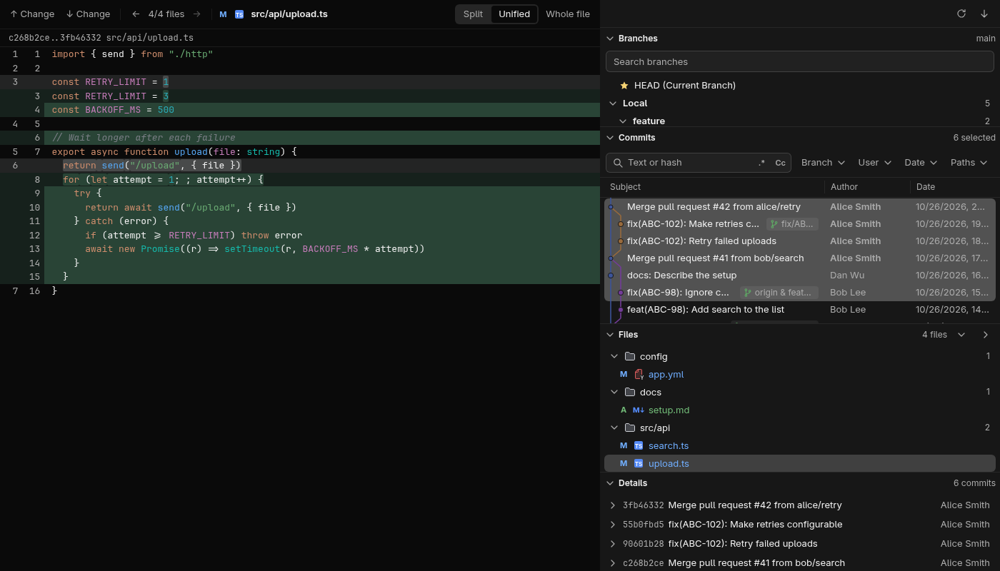
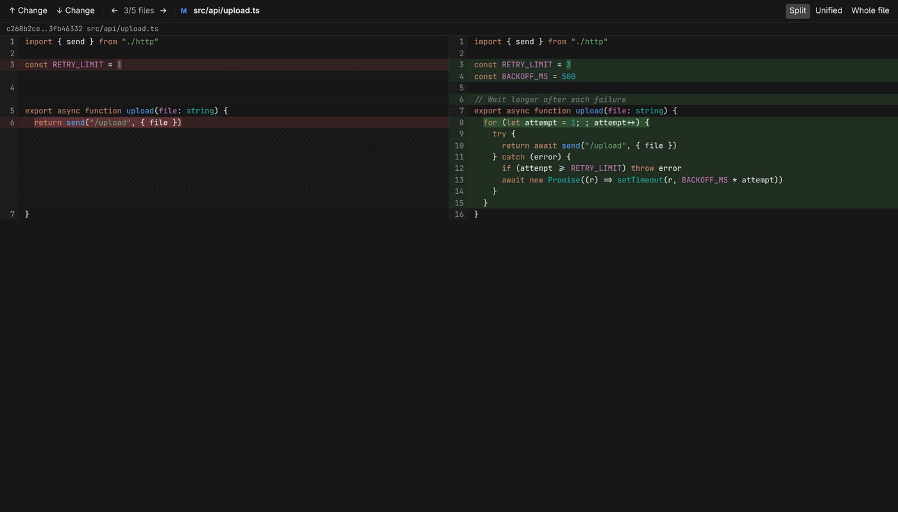
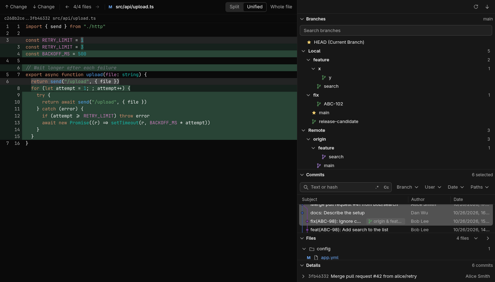

# Git for Orca



## About this fork

This is a fork of [emamalet/Orca-git-log-panel](https://github.com/emamalet/Orca-git-log-panel) that reshapes the interface after the WebStorm Git tool window: a sidebar with a branches tree, the commit list and the files of a multi-commit selection, and a Diff tab for the file you click. The Git engine (`src/worker`) is kept as close to upstream as possible. The design is in [docs/superpowers](docs/superpowers) and the engine review in [docs/engine-review.md](docs/engine-review.md).

To pull in upstream changes:

```sh
git fetch upstream && git log --oneline main..upstream/main
```

Then bring over what you need with `git cherry-pick` or `git merge upstream/main`. Pull requests are not sent to upstream.

An [Orca](https://www.onorca.dev) plugin that adds a WebStorm-style **Git** view to Orca: a branch tree, a
colored commit graph, the files changed by a whole multi-commit selection, a syntax-highlighted diff in an
editor tab, and a right-click menu to rewrite history. The interface follows Orca's language (English and Russian).





## Features

- **Sections**: Branches, Commits, Files and Details stack in a column, like the WebStorm Git tool window. Click
  a header to collapse a section to one line with its summary (current branch, number of selected
  commits); drag the line between open sections to resize them. The layout is remembered.
- **Commit graph**: colored lanes, merges, ref labels (`origin & main`, tags, HEAD), commits not
  reachable from HEAD are dimmed.
- **Filters**: text or hash (with regex `.*` and match case `Cc`), Branch, User, Date and Paths.
- **Branch tree**: HEAD, Local, Remote and Tags, with branches grouped into folders by prefix (`feature/`,
  `fix/`); search by name. Click a branch to filter the log by it (click again to clear), double-click
  to jump to its commit. Right-click for checkout, new branch from it, rename,
  delete (local only; an unmerged branch asks first), merge into the current branch and rebase the
  current branch onto it.
- **Files of the selection**: the changed files of all selected commits as a folder tree with status
  letters (added, modified, deleted, renamed), expand/collapse all. For each file the diff runs from its
  state before the earliest selected commit that touched it to its state after the latest one, so a
  selection across a merge works too. A click (or Enter) opens the file's diff in the Diff tab.
- **Details section**: one row per selected commit (short hash, title, author); click a row to expand
  the full message, author, committer, date and branches. A single selected commit is expanded at once.
- **Diff tab**: one editor tab per repository; the next file you open replaces its content. Side by
  side or unified, with changed words highlighted and syntax highlighting for 26 languages (light and
  dark palettes in the style of WebStorm, the plugin's own because Orca does not pass theme token colors
  to plugins). Toggle **Whole file** for full context, jump between changes with F7 / Shift+F7 and
  between the files of the selection it was opened from with ← / → (keys or header buttons) or Alt+↑ /
  Alt+↓ (counter "3/5 files"). Merge commits are compared with their first parent.
- **Multi-select**: click, Ctrl/⌘-click, Shift-click, arrows, Page Up/Down, Home/End, Ctrl+A.
- **Right-click menu** with icons (or Shift+F10):
  - Copy Revision Number (Ctrl+C), Cherry-Pick, Create Patch… (`git format-patch` of the selection,
    oldest first, saved to a file or copied to the clipboard)
  - Checkout Revision, checkout a branch at that commit, check out a remote branch as local
  - Reset Current Branch to Here… (soft / mixed / hard / keep), Revert Commits, Undo Commit
  - Edit Commit Message…, Fixup, Squash Commits…, Drop Commits, Interactively Rebase from Here…
  - New Branch…, New Tag…
- **Undo** banner after each rewrite (resets back to the previous HEAD with `--keep`).
- Commits already pushed to a remote branch trigger a warning before they are rewritten: by Edit Commit
  Message, Fixup, Squash, Drop, the interactive rebase, Undo Commit or Rebase Current onto This.
- An action runs in the repository its menu was opened on. If the workspace switches to another
  repository while a dialog is open (or, for an action on the current branch, HEAD moves), nothing
  runs and a banner says so. New branch and rename refuse names git would expand, like `@{-1}`.
- **Refresh** re-reads the log and branches; **Fetch** runs `git fetch --all` (without `--prune`) and
  reports the result in the banner. It never asks for a password: it works through the SSH agent and
  git's credential helpers.
- Live refresh when the repository changes (commits, checkouts, fetches, rebases from a terminal).

## Where it shows

- **Right sidebar panel** "Git", the plugin's only view: the Branches, Commits, Files and Details
  sections in one column; in a narrow column a commit takes two lines (message, then author and date).
- **Diff tab**: opens when you click a file in the panel. Orca has no API for a plugin tab without a
  file, so the tab is a custom editor on a small anchor file, `.orca-git-log.gitdiff`, that the plugin
  writes at the root of the workspace holding the repository and adds to `.git/info/exclude`, so it
  never shows up as untracked. It is opened only in a workspace whose repository is the panel's. The
  plugin creates the anchor once and never replaces or writes through anything else of that name (a
  file of yours, a link, a folder): then the tab does not open and the panel says why. An
  anchor `.orca-git-log.gitlog` left by an earlier version (with a full "Git" tab) stays hidden the
  same way and can be deleted.

## Install

```sh
orca plugin install https://github.com/predmaxim/orca-git-log-panel
```

Installed from the Git URL the plugin gets the id `predmaxim.git-log`. Orca first lists the access it
asks for and prints the command to re-run with `--approve <fingerprint>`. If the original plugin is
installed too, turn it off so the two do not both show: `orca plugin disable emamalet.git-log` or
`orca plugin uninstall emamalet.git-log`.

Requires Orca 1.4.248 or later and `git` on the `PATH` (or set **Git executable** in the plugin
settings). The plugin runs as a `trusted-worker`: it starts `git` with your user account.

### Develop

```sh
orca plugin dev load .          # loads as local.git-log; prints a fingerprint, re-run with --approve <fingerprint>
orca plugin test .              # worker and graph tests on temporary repositories
orca plugin validate .
orca plugin shot local.git-log --panel log
orca plugin shot local.git-log --editor <repo>/.orca-git-log.gitdiff   # the Diff tab, once a file was opened from the panel
```

## How history rewriting works

Squash, fixup, drop, reword and the interactive rebase dialog all run `git rebase -i --autostash`
with a generated todo list (`GIT_SEQUENCE_EDITOR`) and messages written to a file, so no editor ever
opens. The selection must be a run of non-merge commits on the current branch. If the rebase stops on
a conflict it is aborted, and the branch is left exactly as it was.

## Limitations

- Local workspaces only: SSH, WSL and paired-host workspaces are not supported yet.
- The diff viewer is read-only, and very large diffs are cut after 20,000 lines.
- The Diff tab steps through at most 2,000 files: for a larger selection it gets the 2,000 around the
  file you clicked.
- The Diff tab's content lives in the plugin's worker: after Orca restarts, a restored Diff tab shows
  its placeholder until you open a file again.
- Conflicts during a rewrite, cherry-pick or revert are not resolved in the panel; the operation is
  aborted (or, when Git is left mid-operation by a terminal command, a banner says so).
- When several workspaces share the same name and branch, the panel matches the focused one through
  its terminal titles; if that is not enough it asks you to pick, and remembers the choice.

## Third-party code

The diff is highlighted with [highlight.js](https://highlightjs.org) 11.12.0 (BSD-3-Clause), vendored as ES modules in `src/vendor/highlight/` (core and 26 language files, 128 KiB, license next to them). They are the npm package `@highlightjs/cdn-assets` byte for byte; the plugin has no build step.

## License

MIT
