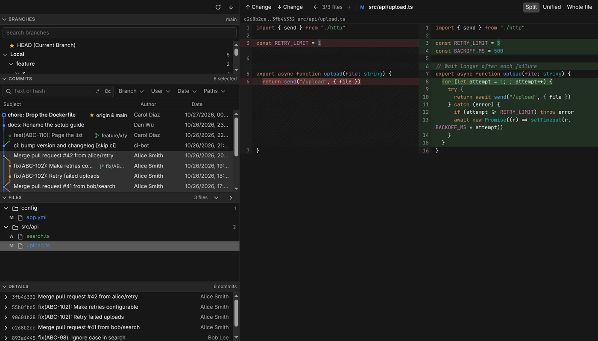

# Git Log for Orca


## About this fork

This is a fork of [emamalet/Orca-git-log-panel](https://github.com/emamalet/Orca-git-log-panel) that reshapes the interface after the WebStorm Git tool window: a branches tree, the commit list and the files of a multi-commit selection with a side-by-side diff. The Git engine (`src/worker`) is kept as close to upstream as possible. The design is in [docs/superpowers](docs/superpowers) and the engine review in [docs/engine-review.md](docs/engine-review.md).

To pull in upstream changes:

```sh
git fetch upstream && git log --oneline main..upstream/main
```

Then bring over what you need with `git cherry-pick` or `git merge upstream/main`. Pull requests are not sent to upstream.

An [Orca](https://www.onorca.dev) plugin that adds a full **Git Log** view to Orca:
a colored commit graph with branch and tag labels, author/date/hash columns, filters, a branch tree,
a details pane with file diffs, and a right-click menu to rewrite history on a multi-selection.




## Features

- **Sections**: Branches, Commits and Files stack in a column, like the WebStorm Git tool window. Click
  a header to collapse a section to one line with its summary (current branch, number of selected
  commits); drag the line between open sections to resize them. The layout is remembered.
- **Commit graph**: colored lanes, merges, ref labels (`origin & main`, tags, HEAD), commits not
  reachable from HEAD are dimmed.
- **Filters**: text or hash (with regex `.*` and match case `Cc`), Branch, User, Date and Paths.
- **Branch tree**: Local, Remote and Tags; click a branch to jump to its commit, double-click to show
  only that branch, right-click to check it out.
- **Details section**: message, author, committer, refs, parents and changed files of the selected commit.
- **Diff viewer**: double-click a changed file (or press Enter on it) to see what the commit changed,
  side by side or unified, with changed words highlighted. Toggle **Whole file** for full context,
  jump between changes with F7 / Shift+F7 and between files with Alt+↑ / Alt+↓; Esc closes it.
  Merge commits are compared with their first parent.
- **Multi-select**: click, Ctrl/⌘-click, Shift-click, arrows, Page Up/Down, Home/End, Ctrl+A.
- **Right-click menu** with icons (or Shift+F10):
  - Copy Revision Number (Ctrl+C), Cherry-Pick, Create Patch… (`git format-patch` of the selection,
    oldest first, saved to a file or copied to the clipboard)
  - Checkout Revision, checkout a branch at that commit, check out a remote branch as local
  - Reset Current Branch to Here… (soft / mixed / hard / keep), Revert Commits, Undo Commit
  - Edit Commit Message…, Fixup, Squash Commits…, Drop Commits, Interactively Rebase from Here…
  - New Branch…, New Tag…
- **Undo** banner after each rewrite (resets back to the previous HEAD with `--keep`).
- Commits already pushed to a remote branch trigger a warning before they are rewritten.
- **Refresh** re-reads the log and branches; **Fetch** runs `git fetch --all` (without `--prune`) and
  reports the result in the banner. It never asks for a password: it works through the SSH agent and
  git's credential helpers.
- Live refresh when the repository changes (commits, checkouts, fetches, rebases from a terminal).

## Where it shows

- **Right sidebar panel** "Git Log": the Branches, Commits, Files and Details sections in one column;
  the log drops columns as the panel narrows.
- **Editor tab**: run **Git Log: Open in Editor Tab** from the command palette (or click the ↗ button
  in the panel) for the sections column on the left and the diff area on the right, with the Details
  section under it. It opens a small anchor file,
  `.orca-git-log.gitlog`, at the workspace root; the plugin adds it to `.git/info/exclude` so it never
  shows up as untracked.

## Install

```sh
orca plugin install https://github.com/emamalet/Orca-git-log-panel
```

Requires Orca 1.4.248 or later and `git` on the `PATH` (or set **Git executable** in the plugin
settings). The plugin runs as a `trusted-worker`: it starts `git` with your user account.

### Develop

```sh
orca plugin dev load .          # prints a fingerprint; re-run with --approve <fingerprint>
orca plugin test .              # worker and graph tests on temporary repositories
orca plugin validate .
orca plugin shot local.git-log --panel log
```

## How history rewriting works

Squash, fixup, drop, reword and the interactive rebase dialog all run `git rebase -i --autostash`
with a generated todo list (`GIT_SEQUENCE_EDITOR`) and messages written to a file, so no editor ever
opens. The selection must be a run of non-merge commits on the current branch. If the rebase stops on
a conflict it is aborted, and the branch is left exactly as it was.

## Limitations

- Local workspaces only: SSH, WSL and paired-host workspaces are not supported yet.
- The diff viewer is read-only, and very large diffs are cut after 20,000 lines.
- Conflicts during a rewrite, cherry-pick or revert are not resolved in the panel; the operation is
  aborted (or, when Git is left mid-operation by a terminal command, a banner says so).
- When several workspaces share the same name and branch, the panel matches the focused one through
  its terminal titles; if that is not enough it asks you to pick, and remembers the choice.

## Third-party code

The diff is highlighted with [highlight.js](https://highlightjs.org) 11.12.0 (BSD-3-Clause), vendored as ES modules in `src/vendor/highlight/` (core and 26 language files, 128 KiB, license next to them). They are the npm package `@highlightjs/cdn-assets` byte for byte; the plugin has no build step.

## License

MIT
