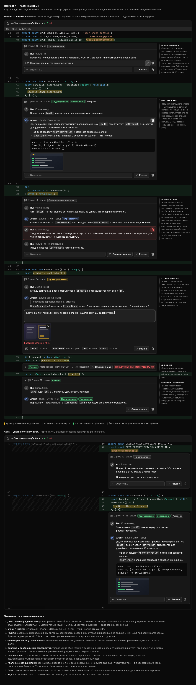
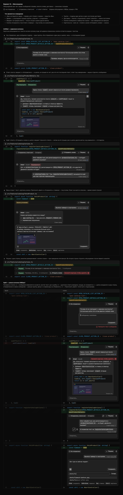
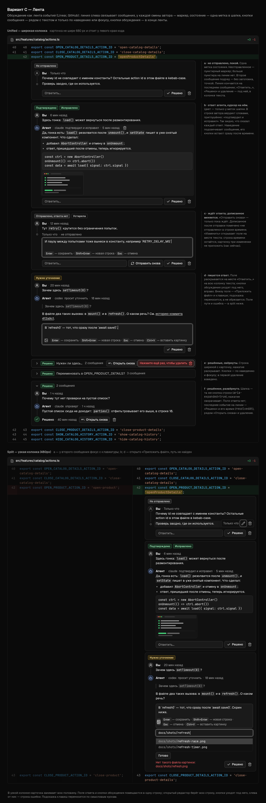

# Карточка обсуждения в диффе: вид «Карточка ревью» — дизайн

Дата: 2026-11-17. Статус: дизайн, не реализован. Это решения пользователя из разговора 2026-11-17. Меняет только вид карточки обсуждения во вкладке «Дифф». Поведение обсуждений, хранение и отправка остаются как в `2026-11-16-review-threads-design.md`, кроме пунктов раздела «Что меняется в поведении».

Источники, все на 2026-11-17: `main` на `74aa63d`; карточка — `src/ui/notes.ts` (`message()` 703–723, `card()` 732–777, `labels()` и `dropTool()` 66–110); стили — `src/ui/styles.css` 2090–2535; макеты — `assets/2026-11-17-thread-card-*.html`, отрисованы в headless Chromium с тёмными значениями Orca 1.4.258.

## Зачем

Пользователь попросил сделать чат обсуждения «более удобным и приятным по дизайну». На его снимке нынешней карточки (unified, окно около 2300 px) видны такие проблемы:

1. Карточка растянута на всю колонку кода. Текст стоит слева, «Решено» и кнопки — справа, примерно в 2000 px от текста.
2. «Не отправлено» повторяется: в метке обсуждения и у каждого сообщения. Для двух сообщений это три раза.
3. Заголовок «Вы · Только что» повторяется у подряд идущих сообщений одного автора.
4. «Изменить» и «Удалить» всегда видны у каждого сообщения.
5. Автор, время и состояние написаны одинаковым мелким приглушённым текстом. Пользователя и агента различает только слабый оттенок фона.
6. «Ответить…» — тяжёлая серая заливка на всю ширину. Она похожа на выключенный элемент.
7. Действия обсуждения стоят отдельно от разговора.

## Варианты

Три независимых дизайнера сделали по варианту, каждый вариант проверил свой критик. Общее у всех трёх: ширина карточки ограничена, «Не отправлено» пишется один раз, подряд идущие сообщения сгруппированы, кнопки сообщения видны только при наведении или фокусе, «Ответить…» — тонкое поле с рамкой.

**A — «Карточка ревью» (выбран).** Как комментарии в pull request'ах GitHub и Azure DevOps: аватары, группы, в шапке «где» и одна метка, все действия обсуждения внизу рядом с «Ответить…». Выбран потому, что лучше всех читается с markdown и кодом, оставляет метки вердиктов как сейчас и меньше всего меняет поведение.

**B — «Мессенджер» (отклонён).** Пузыри: ваши справа, агента слева, доставку показывают значки (часы, галочка, двойная галочка). Отклонён: пузыри съедают высоту, длинный markdown и код в пузыре агента зажаты по ширине, вводится новое состояние «агент ответил».

**C — «Лента» (отклонён).** Сообщения связаны тонкой линией, вердикт написан словами («подтвердил и исправил»). Самый плотный вариант. Отклонён: время сообщений группы видно только при наведении, кнопки сообщения стоят в двух разных местах, нужно 8 новых строк перевода для вердиктов.

Исходники макетов: `assets/2026-11-17-thread-card-a.html`, `-b.html`, `-c.html`. Для A его HTML и CSS — образец размеров, отступов и цветов.

## Как выглядит карточка (A)

**Карточка.** Ширина не больше 760 px. Отступы `6px 10px 10px`. Рамка 1 px `--border`, радиус 8 px, фон `--card` (сейчас плашка `--muted`). В split карточка занимает колонку своей стороны за вычетом отступов. Узкую колонку определяет container query на ширину карточки, не ширина окна.

**Полоса слева.** 2 px, не доходит до скруглённых углов на 8 px. Она есть, только когда метка шапки — вердикт агента, и повторяет её цвет:

- жёлтая — «Нужно уточнение», ход за пользователем;
- синяя — «Отвечено», «Опровергнуто»;
- зелёная — «Подтверждено».

У «Не отправлено», «Отправлено, ответа нет» и «Решено» полосы нет.

**Шапка.** Слева иконка `message-square-text` 14 px. Затем где заметка: «Строка 40 · стало» или «Строки 44–46 · было», 12 px, приглушённо, цифры моноширинные (`tabular-nums`). Затем одна метка состояния по прежнему правилу и, если код изменился, «Устарела» с пунктирной рамкой. Кнопок в шапке нет. В узкой колонке метки переносятся под «где». Текст метки окрашен в цвет её состояния (`color-mix` 80 % с `--foreground`). У «Отправлено, ответа нет» перед текстом иконка `clock` 12 px.

**Сообщение.** Это строка из поля 24 px слева и текста справа. Первое сообщение группы показывает в поле аватар 24 px: у пользователя иконка `user` на `--accent`, у агента `bot` на синем тоне. В заголовке группы: «Вы» или «Агент · claude» (имя 600, вид агента приглушённо) и относительное время 12 px. Полная дата — в подсказке. Под заголовком markdown и миниатюры картинок, как сейчас.

**Группа.** Сообщения идут в одной группе при всех условиях сразу:

- они стоят подряд;
- автор один;
- состояние отправки одинаковое: оба не отправлены или оба ушли с одной отправкой (`review`);
- между соседними не больше 5 минут.

Иначе начинается новая группа с заголовком. У следующих сообщений группы нет ни аватара, ни заголовка. Их время «14:33» появляется в поле слева при наведении или фокусе, полная дата — в подсказке.

**Кнопки сообщения.** «Изменить» есть только у своего неотправленного сообщения, «Удалить сообщение» — у каждого. Кнопки стоят в правом верхнем углу сообщения и видны при наведении и при `:focus-within`. Скрыты они через `opacity` и `pointer-events`, а не `visibility`, чтобы Tab до них доходил. Справа от первой строки оставлено место под кнопки: 32 px, у своего неотправленного 60 px. Кнопки никогда не закрывают текст. При наведении сообщение подсвечивается (`--foreground` 4 %).

**Удаление сообщения.** Первое нажатие: кнопка-иконка 26×26 становится красной (`--destructive` 15 %), сообщение подсвечивается красным (тон 7 %, внутренняя рамка 30 %). Слова «Нажмите ещё раз, чтобы удалить» — в подсказке и `aria-label`, на кнопке их нет. Это `dropTool(..., false)`, как в строке списка «Заметки». Второе нажатие удаляет, уход фокуса, Esc и перерисовка снимают подтверждение, как сейчас. Решение пользователя 2026-11-17: у сообщения в карточке так, а не текстом на кнопке, как было по T-R9. «Удалить обсуждение» по-прежнему показывает текст на кнопке.

**«Не отправлено» у сообщения.** Пишется только в смешанном обсуждении, где есть и отправленные сообщения: после времени, через « · ». Если не отправлено всё, состояние называет только метка шапки.

**Вердикт у сообщения агента.** «Подтверждено» и «Исправлено» не показываются у сообщения в одном случае: обсуждение в состоянии «отвечено», и это его последний ответ. Тогда они уже стоят меткой в шапке. Прошлые ответы и ответы в решённом обсуждении показывают вердикт у себя.

**Нижний ряд.** В одном ряду: «Ответить…», затем «Отправить снова» (только пока ждёт ответа), «Решено» или «Открыть снова», «Удалить обсуждение». «Ответить…» — поле 28 px с иконкой `reply`, рамка `--input`, фон `color-mix(--input 30 %)`, при наведении рамка `--ring`, занимает всё свободное место. Кнопки — контурные 28 px с иконкой 14 px и подписью 12 px. Отступы ряда `6px 12px 12px`. Если кнопок много, а карточка не шире 520 px, «Ответить…» встаёт отдельной строкой над кнопками.

**Редактор.** Встаёт на место «Ответить…». Сверху поле с кольцом фокуса, под ним полоса прикладываемых картинок (с «Убрать») и строка ошибки, как сейчас. Ниже ряд:

- кнопка «Приложить файл» (`image-plus`); сейчас она стоит в полосе картинок;
- подсказка клавишами: `Enter` сохранить · `Shift+Enter` новая строка · `Esc` отмена · `Ctrl+V` картинка; сейчас это placeholder;
- справа действия обсуждения.

Placeholder становится коротким. Поле пути картинки открывается там же, над строкой ошибки. «Изменить» открывает редактор на месте сообщения, как сейчас.

**Решённое обсуждение.** Свёрнутое — одна строка, как сейчас: `chevron-right`, «Решено», первая строка первого сообщения, «N сообщений», «Открыть снова», «Удалить обсуждение». В развёрнутом вся шапка — кнопка «свернуть» с `chevron-down`. Внизу «Открыть снова» и удаление, «Ответить…» нет, как сейчас.

## Что меняется в поведении

Работа кнопок не меняется. Меняются их место, видимость и подписи:

1. «Решено», «Открыть снова», «Отправить снова» и «Удалить обсуждение» переезжают из шапки в нижний ряд. В свёрнутой строке решённого обсуждения они остаются в строке.
2. В шапке появляется «Строка N · было/стало» или «Строки A–B · было/стало».
3. Сообщения группируются по правилу выше. У следующих в группе время видно только при наведении или фокусе и в подсказке.
4. «Изменить» и «Удалить сообщение» видны только при наведении или фокусе. Сейчас они видны всегда.
5. У удаления сообщения после первого нажатия нет текста на кнопке, вместо него подсвечено сообщение. Это меняет T-R9 для сообщения в карточке.
6. «Не отправлено» у сообщения — только в смешанном обсуждении.
7. Вердикт у последнего ответа не повторяется, если он уже в шапке.
8. Подсказка клавиш стоит строкой под полем, а не в placeholder. «Приложить файл» переезжает в ряд под полем.

## Цели и границы

- **Цели:** закрыть проблемы 1–7, не потерять ни одного состояния и действия из `2026-11-16-review-threads-design.md`, работать в unified и в узкой split-колонке, работать с клавиатуры.
- **Не цели:** хранение, отправка агенту, worker, список «Заметки» и строки обсуждений в дереве файлов. Отправка остаётся в меню «Заметки» на панели.
- **Анти-цели:** кнопки, до которых не дойти Tab'ом; текст, который закрывают кнопки; свои цвета сверх трёх цветов состояний (`#fbbf24`, `#4ade80`, `#7aa7ff`); карточка, которая снова тянется на всю ширину.

## Ограничения

- Вид по правилам `orca-plugin-ui`: только токены Orca и три цвета состояний через `color-mix`, иконки Lucide (stroke 2, 14 px в тексте, 16 px в кнопках-иконках), кнопки-иконки 26×26, кнопки 24–28 px, метки 11 px 600, шрифт интерфейса 13 px.
- Те же данные, что сейчас: у заметки `path`, `side`, `start`, `end`, `messages`, `resolvedAt`; у сообщения `author`, `at`, `review`, `sentAt`, `verdict`, `fixed`, `agent`. Новых полей в хранилище нет.
- DOM строится как сейчас, функциями `h()` в `notes.ts`, без фреймворков.

## Что остаётся строителю

- Правило группы и выбор «показывать ли вердикт или „Не отправлено“ у сообщения» — чистые функции рядом с `stateOf`, `lastAnswer` и `unsentOf` (`src/shared/notes.ts:13–34`), с тестами в `src/shared/notes.test.ts`.
- Время «14:33»: `hhmm` уже есть в `src/ui/format.ts:5`, но не экспортирован.
- Иконки: в `ICONS` (`src/ui/dom.ts:85`) уже есть `check`, `undo`, `refresh`, `drop`, `edit`, `image`, `note`, `chevronDown`, `chevronRight`, `close`. Нужно добавить из Lucide: `user`, `bot`, `clock`, `reply`, `image-plus`, `message-square-text` (или взять `note`, если это та же иконка).
- Новые строки i18n (EN и RU): «Строка {n} · {side}», «Строки {start}–{end} · {side}», подсказка клавиш, короткий placeholder.
- Имена классов и раскладка CSS. Образец — макет A, но код берёт имена из нынешних `.d-note*`.
- Обновить README (раздел о карточке обсуждения, строки 121–135) и пункт T-R9 в `2026-11-16-review-threads-design.md`.
- Проверка: стенд headless Chromium по памяти `headless-benches` со снимками тёмной и светлой темы, unified и split 480 px; живая проверка в Orca — только с разрешения пользователя.

## Не проверено

- Светлая тема: макеты отрисованы только с тёмными значениями.
- Вид внутри Orca: макеты не открывались во фрейме плагина.
